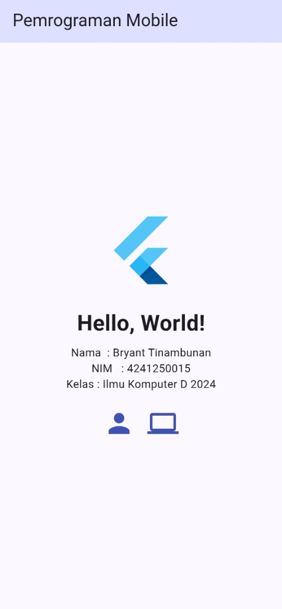

# Tugas Pemrograman Mobile - Hello World Flutter

Repository ini berisi proyek aplikasi Flutter pertama untuk tugas mata kuliah Pemrograman Mobile.

---

## (a) Identitas Mahasiswa

| Keterangan | Data |
| :--- | :--- |
| **Nama** | Bryant Tinambunan |
| **NIM** | 4241250015 |
| **Kelas** | Ilmu Komputer D 2024 |
| **Mata Kuliah** | Pemrograman Mobile |

---

## (b) Keluaran `flutter --version`

Berikut adalah keluaran dari perintah `flutter --version` yang dijalankan melalui terminal:

```bash
Flutter 3.47.8 • channel stable • https://github.com/flutter/flutter.git
Framework • revision 737ba8f885 (2 weeks ago) • 2026-10-22 21:37:31 -0700
Engine • hash dfd2e6cb7d319db05e3bf1503f3e2ac60f6288a2 (revision cf636b1dfb) (14 days ago) • 2026-10-23 02:13:38.000Z
Tools • Dart 3.13.7 • DevTools 2.60.0
```

---

## (c) Tangkapan Layar `flutter doctor`

Berikut adalah hasil pengecekan environment menggunakan `flutter doctor`:

```text
Doctor summary (to see all details, run flutter doctor -v):
[√] Flutter (Channel stable, 3.47.8, on Microsoft Windows [Version 10.0.26200.9445], locale id-ID)
[√] Windows Version (Windows 11 or higher, 25H2, 2009)
[√] Android toolchain - develop for Android devices (Android SDK version 36.0.0)
[√] Chrome - develop for the web
[X] Visual Studio - develop Windows apps
    X Visual Studio not installed; this is necessary to develop Windows apps.
      Download at https://visualstudio.microsoft.com/downloads/.
      Please install the "Desktop development with C++" workload, including all of its default components
[√] Connected device (3 available)
[√] Network resources

! Doctor found issues in 1 category.
```

*(Tangkapan layar dapat disimpan di folder `screenshots/flutter_doctor.png`)*


---

## (d) Tangkapan Layar Aplikasi Berjalan di Perangkat / Emulator

Aplikasi menampilkan `FlutterLogo`, teks `"Hello, World!"`, data identitas mahasiswa (Nama, NIM, Kelas), serta widget `Icon` (ikon orang dan komputer).

<p align="center">
  
</p>

---

## (e) Kendala yang Dialami dan Solusinya

1. **Kendala 1: Komponen Visual Studio belum terpasang saat `flutter doctor`**
   - **Deskripsi:** Saat menjalankan `flutter doctor`, terdapat tanda silang `[X] Visual Studio - develop Windows apps` karena workload C++ untuk Windows Desktop belum terpasang di sistem.
   - **Solusi:** Karena fokus praktikum dan pengembangan saat ini adalah untuk platform Android / Mobile, peringatan ini tidak menghambat jalannya aplikasi pada emulator maupun perangkat fisik Android. Untuk pengembangan aplikasi Windows Desktop di masa mendatang, solusinya adalah menginstal Visual Studio Community beserta workload *"Desktop development with C++"*.

2. **Kendala 2: Validasi modifier `const` saat menambahkan widget baru**
   - **Deskripsi:** Ketika menambahkan widget baru seperti `Icon` dan `Row` ke dalam hirarki `Column`, linter Dart sempat memberikan peringatan mengenai penggunaan keyword `const` pada widget tree.
   - **Solusi:** Menyesuaikan penempatan keyword `const` agar diterapkan pada widget-widget yang nilainya bersifat konstan (seperti `const Icon(...)` dan `const SizedBox(...)`), sehingga kode tetap bersih, efisien, dan lolos analisa `flutter analyze` tanpa warning maupun error.

3. **Kendala 3: Waktu build Gradle awal yang cukup memakan waktu**
   - **Deskripsi:** Pada saat pertama kali menjalankan `flutter run` ke perangkat/emulator Android, proses `Running Gradle task 'assembleDebug'` membutuhkan waktu lama karena mengunduh berbagai dependensi SDK dan library Android.
   - **Solusi:** Memastikan koneksi internet stabil saat build perdana dan membiarkan proses pengunduhan selesai secara penuh tanpa membatalkan terminal. Build berikutnya berjalan jauh lebih cepat karena sudah tercache.
